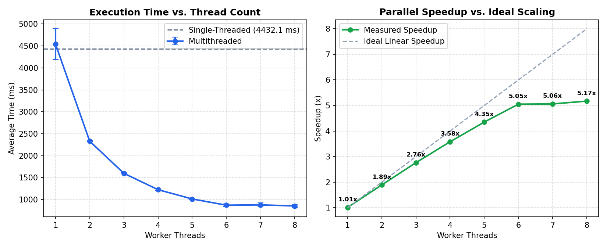
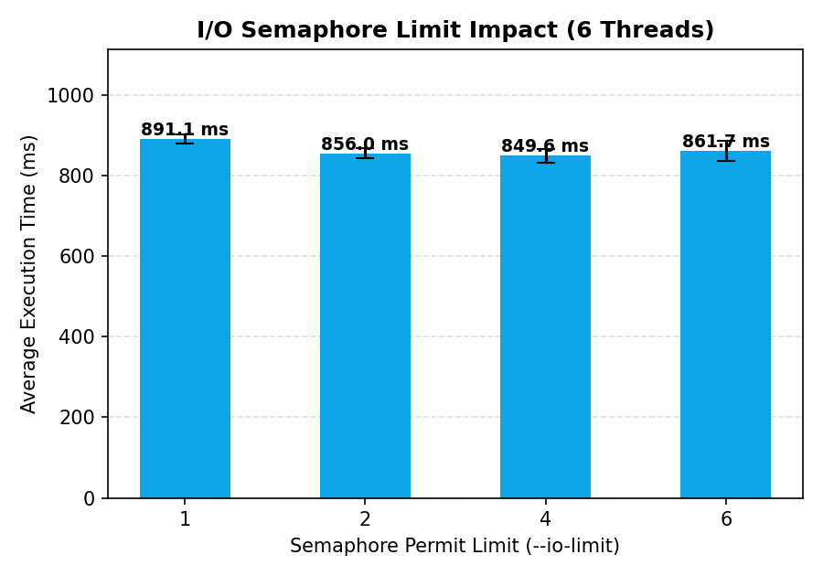

# Parallel Log Processing & Analytics Engine

A high-performance, multithreaded log analysis engine written in **C++11** using native POSIX concurrency primitives (`pthreads`, counting semaphores, mutexes, and `pread()`), paired with a decoupled **Python** (`tkinter` + `matplotlib`) real-time analytics dashboard and an automated benchmarking suite.

Built as a final project for **Operating Systems (CS2006)** at FAST-NUCES Karachi.

---

## Features

- **Newline-Aligned Log Segmentation:** Divides large log files into byte-offset chunks aligned to `\n` boundaries so no entry is split or double-counted across threads.
- **Thread-Safe Concurrent I/O:** Uses POSIX `pread()` for offset-based reads without a shared file cursor, throttled by a counting semaphore (`sem_t io_sem`) scoped strictly around disk reads.
- **Low-Contention Multithreading:** Worker threads dynamically claim chunks via `queue_mutex`, parse completely lock-free into thread-local `Stats` structures, and merge into global counters once per chunk under `stats_mutex`.
- **Severity & Threat Detection:** Classifies every line (`INFO`, `WARNING`, `ERROR`, `CRITICAL`), detects failed logins, invalid users, break-in attempts, and `sudo` failures, extracts IPv4 addresses, and flags brute-force sources (`>= 5` suspicious events).
- **Built-In Integrity Verification:** Warms the OS page cache and compares every multithreaded counter and IP frequency map against a single-threaded baseline (`verified: true`).
- **Real-Time GUI & CSV Export:** Streams `PHASE`, `PROGRESS`, `STATS`, and `RESULT` updates over `stdout` to a live Python dashboard and exports structured summaries to `report.csv`.

---

## Architecture

```text
Log File --> engine.cpp (C++11 POSIX Threads) --> stdout (PHASE / PROGRESS / STATS / RESULT) --> gui.py (Tkinter + Matplotlib)
```

All file I/O, threading, synchronization, and parsing execute inside the native `./engine` binary. Python handles visualization and benchmark automation only.

---

## Project Structure

```text
Parallel-Log-Analytics-Engine/
├── engine.cpp                  # Core C++11 POSIX multithreaded engine
├── gui.py                      # Real-time Python dashboard (Tkinter + Matplotlib)
├── benchmark.py                # Multi-run automated benchmarking & plotting script
├── results/
│   ├── benchmark_results.csv   # Averaged metrics across 120 runs on BGL.log
│   ├── benchmark_scaling.png   # Execution time & speedup vs. thread count (1–8)
│   └── benchmark_io_limit.png  # I/O semaphore permit limit comparison (6 threads)
├── .gitignore
└── README.md
```

---

## Prerequisites

- **OS:** Linux (tested on Ubuntu 24.04 LTS)
- **Compiler:** `g++` with C++11 and POSIX threads support
- **Python 3:** `tkinter` and `matplotlib`

```bash
sudo apt update
sudo apt install g++ python3 python3-tk python3-matplotlib
```

---

## Build & Usage

### 1. Compile the Engine

```bash
g++ -O2 -std=c++11 -pthread engine.cpp -o engine
```

### 2. Run via CLI

```bash
./engine <logfile> [--threads N] [--io-limit K] [--csv report.csv]
```

Example:

```bash
./engine samples/SSH.log --threads 4 --io-limit 2 --csv report.csv
```

### 3. Launch the GUI Dashboard

```bash
python3 gui.py
```

Select any `.log` or `.txt` file, set the thread count and I/O semaphore limit, and click **Run Analysis**.

### 4. Run Automated Benchmarks

```bash
python3 benchmark.py samples/BGL.log --threads 1,2,3,4,5,6,7,8 --io-limits 1,2,4,6 --io-threads 6 --runs 10
```

Outputs `benchmark_results.csv`, `benchmark_scaling.png`, and `benchmark_io_limit.png` into `results/`.

---

## Datasets

Log files are excluded from this repository due to size limits. Benchmarks and validation used public datasets from the [Loghub](https://zenodo.org/records/8196385) repository:

- **`BGL.log`** (~708 MB, 4.7M lines) — Parallel scaling and semaphore stress tests.
- **`SSH.log`** (~70 MB, 655,147 lines) — Security pattern detection, brute-force IP flagging, and GUI verification.

---

## Benchmark Summary

Evaluated on an **Ubuntu 24.04 LTS VM (6 logical CPU cores, 6 GB RAM)** over **120 runs** (10 runs per configuration) on `BGL.log`. Every run passed integrity verification (`verified = true`).

### Thread Scaling (`--io-limit 2`)

| Threads | Avg Single (ms) | Avg Multi (ms) | Std Dev (ms) | Speedup | Efficiency | Verified |
| :---: | :---: | :---: | :---: | :---: | :---: | :---: |
| 1 | 4,588.28 | 4,540.49 | 351.33 | 1.01x | 101.0% | TRUE |
| 2 | 4,396.93 | 2,329.70 | 17.43 | 1.89x | 94.5% | TRUE |
| 3 | 4,403.43 | 1,597.71 | 13.26 | 2.76x | 92.0% | TRUE |
| 4 | 4,390.38 | 1,225.22 | 16.75 | 3.58x | 89.5% | TRUE |
| 5 | 4,408.83 | 1,013.39 | 16.22 | 4.35x | 87.0% | TRUE |
| **6** | **4,402.06** | **871.75** | **26.82** | **5.05x** | **84.2%** | **TRUE** |
| 7 | 4,444.70 | 878.60 | 43.73 | 5.06x | 72.3% | TRUE |
| 8 | 4,421.97 | 854.51 | 39.44 | 5.17x | 64.6% | TRUE |



### I/O Semaphore Impact (`--threads 6`)

| Threads | `--io-limit` | Avg Single (ms) | Avg Multi (ms) | Std Dev (ms) | Speedup | Verified |
| :---: | :---: | :---: | :---: | :---: | :---: | :---: |
| 6 | 1 | 4,412.47 | 891.07 | 10.73 | 4.95x | TRUE |
| 6 | 2 | 4,374.80 | 855.95 | 12.15 | 5.11x | TRUE |
| **6** | **4** | **4,360.18** | **849.58** | **16.25** | **5.13x** | **TRUE** |
| 6 | 6 | 4,411.19 | 861.68 | 25.52 | 5.12x | TRUE |



### Key Takeaways

- **Near-Linear Scaling to Core Limit:** Reached **5.05x speedup** (84.2% efficiency) at 6 threads before plateauing at 7–8 threads due to CPU oversubscription on 6 logical cores.
- **I/O Semaphore Sweet Spot:** Setting `--io-limit` to `2`–`4` outperformed serialized reads (`1`) by ~4.7% while avoiding the higher timing variance observed at `6`.

---

## Author

**Muhammad Daniyal Alam** (24K-2048) — Section BCY-5A  
Operating Systems (CS2006) — Instructor: Sir Sandesh Kumar
